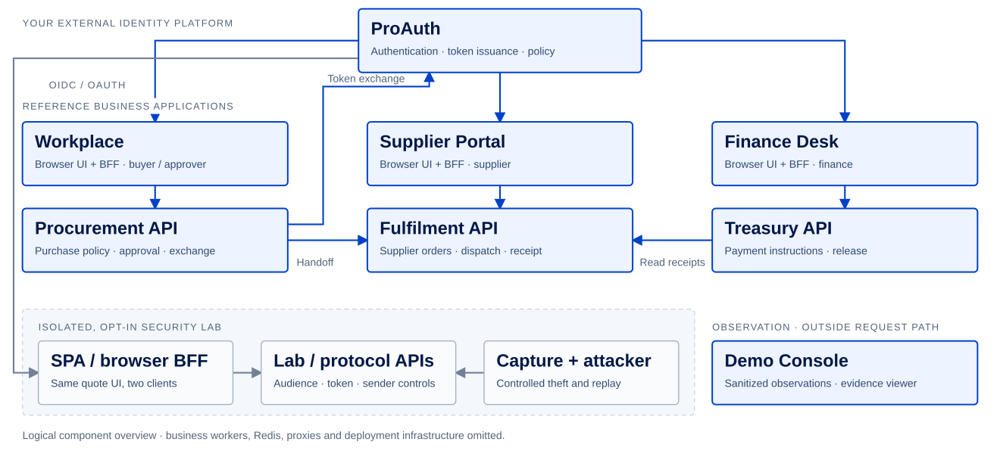

# ProAuth reference implementation

Explore how OpenID Connect and OAuth fit into a business application. This reference follows a purchase through the fictional **Mervikon Group**: an employee requests equipment, a manager approves it, a supplier fulfils the order, a warehouse confirms receipt, and finance releases an internal payment instruction.

The implementation uses ASP.NET Core, React, TypeScript, and ProAuth's BFF, client, and resource-server packages. It is intended for customers, conference attendees, and developers who want to try the flows and study the integration code.

For a walkthrough of the architecture, request *Beyond the OAuth Basics*. Complete the form and ProAuth will email you a download link. [Get the whitepaper](https://www.proauth.net/downloads/beyond-the-oauth-basics)

## Get a free ProAuth trial

If you’re evaluating ProAuth, select **Start a free trial** on the contact form and mention the Mervikon reference application so the team can enable the Enterprise features it uses. The trial includes access to the ProAuth NuGet feeds and container registry. [Request a free trial](https://www.proauth.net/contact/)

You can also follow the code without running the applications. Start with [Amir’s purchase approval handler](src/services/Procurement.Api/ProcurementEndpoints.cs).

## Run with ProAuth

Use a **ProAuth test installation with Enterprise features** and credentials for the ProAuth customer package feed. The standard setup provisions dedicated clients, fictional accounts, custom claim rules, and branded sign-in views. ProAuth runs separately from the reference applications.

Run `npm start` from the repository root. On a fresh clone it creates private setup templates. Fill in your installation settings and run the same command to provision ProAuth, start the reference containers and check Workplace. See [connecting your ProAuth installation](docs/running.md#connect-your-proauth-installation).

**Version compatibility:** this checkout uses ProAuth 3.4.0 packages and CLI from the customer feed. Use a compatible ProAuth server and follow the [dependency setup](docs/development.md#proauth-dependency) before building.

## Architecture overview

Each browser application has a backend for frontend (**BFF**) and a corresponding business API. The BFF keeps OAuth tokens on the server. Procurement exchanges a token at ProAuth to hand an approved order to Fulfilment; Treasury uses its own workload identity to retrieve receipts from Fulfilment.

**ProAuth provides identity and protocol operations:** sign-in, passkeys, token issuance, authentication policies, and token exchange. **The reference application provides the business decisions:** who may approve a purchase, which supplier may see an order, and which warehouse may receive it. Its business memberships are operator-owned mappings of validated identities to application permissions.

The optional security lab makes controlled attacks and negative cases observable. Demo Console displays collected evidence outside the business request path. Workers, shared session storage, and deployment infrastructure are omitted from this diagram; see [architecture and trust boundaries](docs/architecture.md) for details.

## What is implemented?

There are two ways to explore Mervikon: **play through the connected business story**, or **find a particular integration pattern to use in your own application**. The optional experiments below provide additional protocol and security demonstrations.

### Play through the equipment purchase

Mervikon Group buys equipment from Northstar Components, and Alpine Logistics receives it. The same purchase passes through employees, an external supplier, automated workers, a warehouse terminal, and finance.

| Step | Actor and application | What happens | Identity lesson |
| --- | --- | --- | --- |
| 1. Request | **Elena · Workplace** | Request the CHF 18,500 calibration station. It becomes **Requested**. | Interactive sign-in through a BFF and access to a protected API. |
| 2. Approve | **Amir · Workplace**, in a separate browser profile | Approve Elena's purchase. It becomes **Approved**. | A valid sign-in still needs the right organization, role, spending limit, and separation of duties. |
| 3. Hand off | **Amir · Workplace → Procurement → Fulfilment** | Choose **Hand to supplier**. Fulfilment creates an **Assigned** supplier order. | Delegated token exchange narrows audience and scope; the calling API uses its own DPoP key. |
| 4. Accept | **Sam · Supplier Portal** | Accept Northstar's assigned order. It becomes **Accepted**. | A partner application sees only the orders assigned to its organization. |
| 5. Dispatch | **Dispatch worker · command line** | Dispatch the accepted order. It becomes **Dispatched**. | An automated client acts with its own workload identity and limited permissions. |
| 6. Receive | **Lea · Warehouse Terminal and browser** | Authorize the terminal using its displayed device code and confirm receipt. The order becomes **Received**. | Device authorization connects a terminal to a person without collecting their password in the terminal. |
| 7. Release | **Priya · Finance Desk** | Import the receipt to create a **Pending** payment instruction, verify identity when required, then explicitly release it. It becomes **Released**. | Fresh strong authentication supplements finance permissions and exact amount, recipient, and revision checks. |

[Configure and start the reference](docs/running.md), then follow the [step-by-step business walkthrough](docs/walkthrough-local.md) for addresses, commands, account setup, and expected results. Use separate browser profiles for the actors. Before signing in, follow the [password checklist](docs/walkthrough-local.md#passwords-and-first-use-setup) and [prepare Priya for payment verification](docs/walkthrough-local.md#prepare-priya-for-payment-release). No real bank or payment provider is connected.

For an additional branch, request the CHF 24,900 item: approvals above CHF 20,000 require fresh strong authentication. After verification, the record remains unchanged until Amir explicitly approves again. A separate reconciliation worker can read payment records without authority to release them.

### Find an integration example for your application

Open `Mervikon.slnx`. Each service's `Program.cs` explains its security role and shows the ProAuth registration and middleware directly. Named endpoint handlers explain the caller checks, while domain classes contain business rules. Read [how to follow a security feature through the code](docs/architecture.md#reading-the-integration-code) for a source-first path from the whitepaper to the implementation.

Start with the linked application code and configuration. Protocol validation, token storage, and authentication ceremonies are supplied by the ProAuth packages or server; these examples show how the application integrates and uses them.

| Feature you want to implement | Where to start in the code | Configuration and walkthrough |
| --- | --- | --- |
| **Browser sign-in, BFF proxy, server-side tokens, refresh, and logout** | [Workplace host](src/apps/Workplace.Bff/Program.cs), [shared session infrastructure](src/apps/shared/BffHosting.cs), and [browser API helper](src/apps/shared/api.ts) | [BFF authentication and proxy settings](src/apps/Workplace.Bff/appsettings.json), [client registration](config/proauth/clients/20-workplace.yml) |
| **API token validation and scope authorization** | [Fulfilment startup](src/services/Fulfilment.Api/Program.cs), [shared validation conventions](src/shared/Common.Security/ApiSecurity.cs), and [Fulfilment endpoints](src/services/Fulfilment.Api/FulfilmentEndpoints.cs) | [Resource-server settings](src/services/Fulfilment.Api/appsettings.json), [architecture](docs/architecture.md) |
| **Organization boundaries and business authorization** | [Identity-to-membership mapping](src/shared/Common.Security/Memberships.cs), [purchase rules](src/services/Procurement.Domain/PurchaseBook.cs), [supplier/warehouse rules](src/services/Workflow.Domain/OrderBook.cs), and [payment rules](src/services/Workflow.Domain/PaymentBook.cs) | [Decision trace and assignment updates](docs/authorization.md), [membership setup](docs/running.md#business-membership-and-the-first-journey), [trusted context disclosure](config/proauth/policies/30-trusted-context.yml) |
| **Delegated token exchange and downstream DPoP** | [Procurement handoff](src/services/Procurement.Api/ProcurementEndpoints.cs), [outbound client setup](src/services/Procurement.Api/Program.cs), and [downstream actor validation](src/shared/Common.Security/ExchangeActor.cs) | [Exchange client and policy](config/proauth/clients/21-workflows.yml), [exchange contract](docs/architecture.md#exchange-security-contract) |
| **Step-up for a sensitive API operation** | [API assurance requirement](src/shared/Common.Security/SensitiveActionAssurance.cs), [BFF verification form](src/apps/shared/StepUpEndpoints.cs), and [explicit browser confirmation](src/apps/Workplace/src/main.tsx) | [Client assurance policies](config/proauth/clients/21-workflows.yml), [step-up walkthrough](docs/api-assurance.md) |
| **Passkeys and navigation to account security** | [Validated account-security link](src/apps/shared/AccountSecurityLink.cs) and [Workplace endpoint](src/apps/Workplace.Bff/Program.cs). Enrollment and sign-in ceremonies run in ProAuth. | [Navigation claim rule](config/proauth/policies/31-account-security.yml), [account walkthrough](docs/account-security.md) |
| **Machine-to-machine access** | [Dispatch and reconciliation worker](src/clients/Integration.Worker/Program.cs), [Treasury receipt client](src/services/Treasury.Api/TreasuryEndpoints.cs) | [Workload client registrations](config/proauth/clients/21-workflows.yml), [worker deployment settings](deploy/compose/compose.yml) |
| **Device authorization for a terminal** | [Warehouse Terminal](src/clients/Warehouse.Terminal/Program.cs) | [Device client registration](config/proauth/clients/22-warehouse.yml), [purchase-to-receipt walkthrough](docs/walkthrough-local.md#purchase-to-receipt) |
| **FAPI-profile client integration** | [Finance Desk host](src/apps/FinanceDesk.Bff/Program.cs) and [settings for PAR, private-key authentication, and DPoP](src/apps/FinanceDesk.Bff/appsettings.json) | [Finance client registration](config/proauth/clients/21-workflows.yml), [finance assurance journey](docs/api-assurance.md) |
| **Shared BFF sessions across replicas** | [Redis-backed BFF stores and locks](src/apps/shared/BffHosting.cs) | [Replica overlay](deploy/compose/bff-replicas.yml), [session, refresh, failover, and logout checks](docs/bff-replicas.md) |
| **Sanitized protocol and business observations** | [Evidence library](src/shared/Common.Evidence/), [business result projection](src/shared/Common.Security/WorkflowEvidence.cs), and [Demo Console](src/demo-console/DemoConsole/) | [Evidence viewer guide](docs/demo-console.md) |

### Explore the optional security experiments

These components use separate fixtures and opt-in configuration. Deliberately unsafe clients, collectors, and replay tools belong to the teaching lab; study the secure application examples above when integrating your own application.

| Experiment | What you can observe | Source and instructions |
| --- | --- | --- |
| **SPA versus BFF** | A compromised script steals the SPA's token. The BFF keeps its OAuth token server-side, while a malicious same-origin script can still make session-authenticated requests. | [Browser comparison](labs/unsafe/Demo.Browser/), [attacker service](labs/unsafe/Demo.Attacker/), [walkthrough](docs/conference.md) |
| **Bearer versus DPoP replay** | Controlled capture and independent replay compare bearer reuse with sender-bound request rejection. | [Capture](labs/unsafe/SecurityLab.Capture/), [victim](labs/unsafe/SecurityLab.Victim/), [replay runner](labs/unsafe/SecurityLab.Runner/), [setup](docs/running.md#local-demo-console-and-isolated-comparison) |
| **JWT, opaque tokens, encrypted tokens, and mTLS** | Compare validation and revocation behavior, signed introspection, tampered ciphertext, and missing or mismatched certificates. | [Protocol API](labs/protocols/ProtocolLab.Api/), [probe](labs/protocols/ProtocolLab.Probe/), [registrations](config/proauth/protocols/), [walkthrough](docs/protocol-controls.md) |
| **Distributed DPoP replay storage** | Reuse one proof across two APIs, exercise concurrent requests, and stop/restart the dedicated Redis replay store. | [Redis replay store registration](labs/unsafe/SecurityLab.Api/Program.cs), [replica overlay](deploy/compose/replicas.yml), [walkthrough](docs/replica-controls.md) |
| **Nonce and FAPI negative controls** | Exercise DPoP nonce negotiation and selected PKCE/PAR guardrails against the real server. | [Demo probe](labs/protocols/Demo.Probe/Program.cs), [commands and limits](docs/conference.md#optional-runnable-extensions) |

The presentation selects particular parts of this implementation: baseline sign-in, sender constraints, the SPA/BFF comparison, delegated exchange, and optional approval step-up. The full business journey also includes supplier processing, workload clients, warehouse device authorization, and finance. Use **Demo Console** to inspect collected observations and completed experiment results; it does not execute the business actions for you.

For builds and tests, see [development](docs/development.md). Application sources are under `src/`, opt-in experiments under `labs/`, identity resources under `config/proauth/`, and deployment examples under `deploy/`.

## Reference scope

Business data is held in memory and clears when its owning API restarts. Keep identity data, Redis security state, and keys intact when resetting business records. The runnable journey uses native ProAuth identities; upstream federation and SCIM synchronization are not currently included. The Helm chart covers only the initial Workplace/Procurement slice.

Demo Console and deliberately unsafe labs are local operator tools. Recorded results describe a particular run and do not establish protocol conformance. See [security boundaries](SECURITY.md) before enabling the labs and [contributing](CONTRIBUTING.md) before changing the implementation.

## License

This repository is **source available** under the [ProAuth Reference Implementation License 1.0](LICENSE.md).

You may study, modify, and share it for evaluation, conferences, and training, including paid training. You may reuse its code in commercial applications that genuinely integrate ProAuth, including production applications and work performed by implementation partners. Keep the required license and attribution notices; you do not have to publish your application's source code.

Using the reference code in competing identity products, competing reference applications, or sales demonstrations promoting competing identity platforms requires separate written permission. The restrictions concern the use, not simply who employs you. Independent research, criticism, and fair technical comparisons remain permitted.

ProAuth itself and third-party dependencies keep their separate licenses. This summary is informational; the [full agreement](LICENSE.md) governs. For additional permissions, contact [info@4tecture.ch](mailto:info@4tecture.ch).
